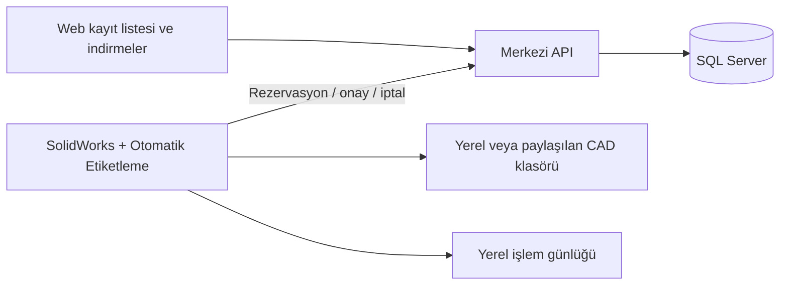

# Solidworks Otomatik Parça ve Montaj Etiketleme

### SolidWorks için otomatik etiketleme ve merkezi kayıt takibi

**Otomatik Etiketleme**, parça ve montajlara ortak bir merkezden dosya numarası verir. SolidWorks içindeki normal kayıt akışıyla çalışır; başarılı kayıtlar web arayüzünden aranır ve takip edilir. Küçük ekiplerin aynı numarayı iki kez kullanmadan, dosya adlarını elle yönetmeden çalışması için geliştirilmiştir.

**Güncel sürüm:** Kaydet35 · `2026.11.16.1`
**Kaynak güncellemesi:** 16 Kasım 2026
**Hedef:** Windows x64 · SolidWorks 2020–2023 veya 2027 · SQL Server

> Otomatik Etiketleme ile yapay zekâ destekli **SolidWorks Co-Pilot** ayrı eklentilerdir. Bu depo otomatik etiketleme uygulamasının kaynaklarını ve iki paket için kullanılan web indirme arayüzünü içerir. Ayrı Co-Pilot ürününün derlenmiş DLL/EXE dosyaları burada dağıtılmaz.

## Özellikler

| İşlem | Sonuç |
| --- | --- |
| İlk parça / montaj kaydı | Merkezden `P00001.SLDPRT` / `M00001.SLDASM` biçiminde ad alınır. |
| Normal Kaydet / Ctrl+S | Mevcut numara korunur, yeni belge kaydı oluşmaz. |
| Yeni dosya oluşturan Farklı Kaydet | Yeni dosya için ayrı numara alınır. |
| Bağımsız Yap | Bileşen yeni dosyaya kaydedilir; montaj referansı ve merkezi sonuç doğrulanır. |
| Parasolid, STEP, DXF ve diğer dış formatlar | SLDPRT/SLDASM dışındaki dışa aktarmalarda yeni etiket veya web kaydı oluşturulmaz. |
| Bağlantı kesintisi | Aynı işlem kimliği ve yerel işlem günlüğü korunur; sonuç sonradan toparlanabilir. |
| Web arayüzü | Arama, parça/montaj filtresi, sayfalama, TSİ tarihleri ve dosya adı kopyalama. |
| İndirmeler | Otomatik Etiketleme ve ayrı Co-Pilot paketleri için düzenli indirme sayfası. |

Kaydet34 R2, kayıt iptalini önce bilgisayardaki kalıcı günlüğe yazar; merkezi iptal yanıtı kayıt penceresini bekletmez. Arka plan gönderimi aynı işlem kimliğini kullanır. Bağlantı geldiğinde güvenli iptaller tamamlanır.

**Araçlar → Otomatik Etiketleme → Kayıtları toparla** menüsünden bekleyen işlemler görülebilir. Dosya kanıtı doğrulanabilen sonuçlar aynı işlem kimliğiyle tamamlanır; CAD yeniden yazılmaz ve yeni numara ayrılmaz. Belirsiz yazımlar veya kanıtı değişmiş dosyalar otomatik silinmez. Bu araç tüm bekleyen işlemleri sıfırlayan bir düğme değildir.

Kaydet33'te eklenen bağımsız kayıt kuyruğu korunur. Kendi kayıt penceresi kapandıktan sonra uygun boşta durumda CAD yazımı tek kez yürütülür.

## Mimari



API ve SQL merkez bilgisayarda; eklenti SolidWorks kullanılan bilgisayarlarda çalışır. CAD dosyaları merkezi API'ye yüklenmez. Dosyaların konumunu kullanıcı belirler.

Uygulama güvenilen yerel ağ kullanımı içindir. API'de kullanıcı kimlik doğrulaması bulunmaz; çalışan servisi doğrudan internete açmayın. Kaynakların GitHub'da açık olması, şirket verilerinin veya çalışan API'nin yayımlanması anlamına gelmez.

## Kullanıcı kurulumu

1. Merkezin web sayfasında **İndirmeler** bölümünü açın.
2. **Etiketleme eklentisini indir** düğmesiyle ZIP'i alın ve çıkarın.
3. SolidWorks'ün tüm sürümleri kapalıyken ZIP'teki kurulum EXE'sini çalıştırın. Mevcut kurulumda **Güncelle** seçeneğini kullanın.
4. Merkez API adresini doğrulayın; başka bilgisayardan bağlanırken `127.0.0.1` yerine merkezin erişilebilir adresini kullanın.
5. SolidWorks'te eklentiyi etkinleştirin ve ilk test kaydını web listesinden kontrol edin.

Her indirme paketi `README-KURULUM.txt` içerir. Kurulum/eklenti listesinde eski **Pronom** adı görülebilir; mevcut kurulumlarla uyumluluk korunmuştur.

### Ayrı Co-Pilot paketi

Webdeki **Co-Pilot’u indir** bağlantısı tam kurulum/güncelleme ZIP'ine yönelir. Kullanıcı ZIP'i kalıcı klasöre çıkarır, SolidWorks'ü kapatır ve `KURULUM.cmd` dosyasını çalıştırır. Bu klasör kurulumdan sonra taşınmamalı veya silinmemelidir.

[`outputs/copilot-kurulum`](outputs/copilot-kurulum) yalnız bize ait kurulum betiğini, README'yi ve dosya hash manifestini içerir; lisanslı eklenti DLL'leri dahil değildir. Kendi yetkili dağıtımınızı hazırlamak için manifestteki beş DLL'yi `dist/addin-v24` altına yerleştirin ve `Kurulum.ps1 -Dogrula` ile doğrulayın. Co-Pilot'un bu sürümünde dosya numaralandırması kaldırılmıştır. Sohbet için mevcut hesap/Codex bağlantısı ayrıca gerekir; bu paket o bağımlılığı kaldırmaz.

**Kurulum R2:** RegAsm uyarıları işlem çıktısında saklanır; kurulum kararı süreç çıkış kodu ve gerçek CodeBase kontrolüyle verilir. Yeni R2 kurulumunun istemci kabulü hâlâ beklemektedir. Co-Pilot için burada SolidWorks 2020 uyumluluk garantisi verilmez.

## Kaynaktan derleme

Gerekenler: Windows x64, .NET SDK 10, .NET Framework 4.8 Developer Pack ve lisanslı SolidWorks kurulumunuzdan alınan API referansları. SQL Server merkezi API için gerekir.

Aşağıdaki üç dosyayı kendi referans klasörünüzde bulundurun:

```text
SolidWorks.Interop.sldworks.dll
SolidWorks.Interop.swconst.dll
SolidWorks.Interop.swpublished.dll
```

Depo kökünde:

```powershell
& .\outputs\kurulum\GitHubKaynakDerle.ps1 -SolidWorksApiKlasoru 'C:\SolidWorks-API-Referanslari'
```

Betik eklentiyi, hedef pencere okuyucusunu ve kurulumu derler; setup'ın kendi kontrollerini çalıştırır. Sonuç `work/github-build/bin/Etiket.Kurulum/release/Pronom.Kurulum.exe` konumundadır. Betik bilgisayara eklenti kurmaz, COM kaydı yapmaz, API başlatmaz veya veritabanını değiştirmez. API referansları ve oluşturulan ikili dosyalar Git dışında kalır.

2020–2023 ve 2027 hedefleri için temel derleme 2020 API referanslarıyla yapılır. Daha yeni API referanslarıyla derlemek, eski sürüm uyumluluğunu tek başına kanıtlamaz.

### Merkezi API

Önce kendi SQL veritabanınızın şemasını hazırlayın. `outputs/sql` betiklerini inceleyip hedefi doğrulayın; hepsini mevcut veritabanında sırayla çalıştırmayın. Temiz başlangıç ve yedekleme betikleri mevcut veriler için ayrıca planlanmalıdır.

Örnek Windows oturumu bağlantısı:

```powershell
$env:ConnectionStrings__MerkeziVeritabani = 'Server=localhost;Initial Catalog=Pronom_Kullanim;Integrated Security=True;Encrypt=True;TrustServerCertificate=True'
dotnet run --project .\outputs\src\Etiket.Api --urls http://127.0.0.1:5082
```

Bu başlatma veritabanı oluşturmaz veya sıfırlamaz. Yerel web adresi `http://127.0.0.1:5082`, sağlık kontrolü `/api/health` olur. Sunucu, sertifika ve ağ ayarlarını kendi ortamınıza göre düzenleyin. Depodaki `192.0.2.10` yalnız örnek adrestir.

### Web indirmelerini yayımlama

`SetupYayinla.ps1` doğrulanmış setup EXE'sini ve aynı EXE + README içeren `Otomatik-Etiketleme-Kurulum.zip` paketini webin `indir` klasörüne yayımlar. Co-Pilot kurulumu ayrı hazırlanır. Web sayfasındaki bağlantılar, ilgili dosyalar merkezde yerleştirildikten sonra kullanılabilir; bu GitHub deposu hazır kurulum dosyaları barındırmaz.

`PronomSetupHazirla.ps1` geliştirici ortamındaki tarihsel güncelleme girdilerine dayanır. Temiz klon için `GitHubKaynakDerle.ps1` kullanın.

## Doğrulama ve sınırlar

- Kaydet35, 2020 ve 2023 API referanslarıyla ayrı ayrı hatasız derlendi. Her iki çalıştırmada 958 çekirdek kontrol geçti.
- SolidWorks 2027 algılaması ve Kaydet34 R2 üzerinden güncelleme, kurulum testlerinde doğrulandı. SolidWorks 2027 ile gerçek CAD kayıt testi yapılmadı.

- Kaydet34 R2, 2020 ve 2023 API referanslarıyla ayrı ayrı hatasız derlendi; her iki çalıştırmada 951 çekirdek kontrol geçti.
- Çevrimdışı iptal, yanıt kaybı, yeniden başlatma ve aynı işlem kimliğiyle güvenli tekrar kontrollü testlerde doğrulandı.
- 80 dışa aktarım penceresi ve 16 kayıt girdisi kontrolü geçti. Bunlar kendi Windows test pencerelerinde çalışır; gerçek CAD kabulünün yerine geçmez.
- Kurulum çekirdeği, eski sürümlerden güncelleme ve DPI/arayüz kontrolleri geçti.
- 4 Kasım 2026'da SolidWorks 2023 SP0.1 üzerinde toparlama menüsü, belirsiz günlükleri koruma, iptal-sonrası tekrar, geometrili parça ve montajın Farklı Kaydet işlemleri, Bağımsız Yap, montajı kapatıp açma, Ctrl+S ve tek merkezi kayıt kontrolleri geçti.
- Aynı gün SolidWorks 2020 SP4.0 üzerinde toparlama menüsü, iptal-sonrası tekrar, geometrili parça kaydı ve Ctrl+S kontrolleri geçti. 2020'de Bağımsız Yap ve dışa aktarım bu son turda yeniden sınanmadı.
- Kaydet34 R2 web indirme paketi 4 Kasım'da yayımlandı ve indirilen ZIP'in içindeki EXE hash'i doğrulandı.
- Her servis paketi ve ağ ortamı fiziksel olarak sınanmış değildir. Sorunlu istemcinin ağında Kaydet34 R2 kabulü henüz yapılmadı; ağ kök nedeninin giderildiği iddia edilmez.

## Depo düzeni

```text
outputs/
├── src/                 # API/web, SolidWorks eklentisi, okuyucu ve setup kaynakları
├── tests/               # Çekirdek, HTTP, pencere ve kurtarma kontrolleri
├── sql/                 # Şema ve kontrollü geçiş betikleri
├── kurulum/             # Derleme, dağıtım ve bakım araçları
└── copilot-kurulum/     # Ayrı Co-Pilot için kurulum betikleri; DLL içermez
```

## Paylaşım kapsamı

Gerçek CAD belgeleri, SQL verileri/yedekleri, işlem günlükleri, kişisel yollar, gerçek bağlantı ayarları, hesap/oturum bilgileri ve lisanslı ikili bağımlılıklar bu depoya dahil değildir. Yerel dosyalar ve hassas ayarlar `.gitignore` ile kapsam dışında tutulur.

Bu güncelleme mevcut herkese açık deponun geçmişini korur. Şu aşamada açık kaynak lisansı eklenmemiştir; yeniden kullanım ve dağıtım izinleri için depo sahibiyle iletişime geçin.
